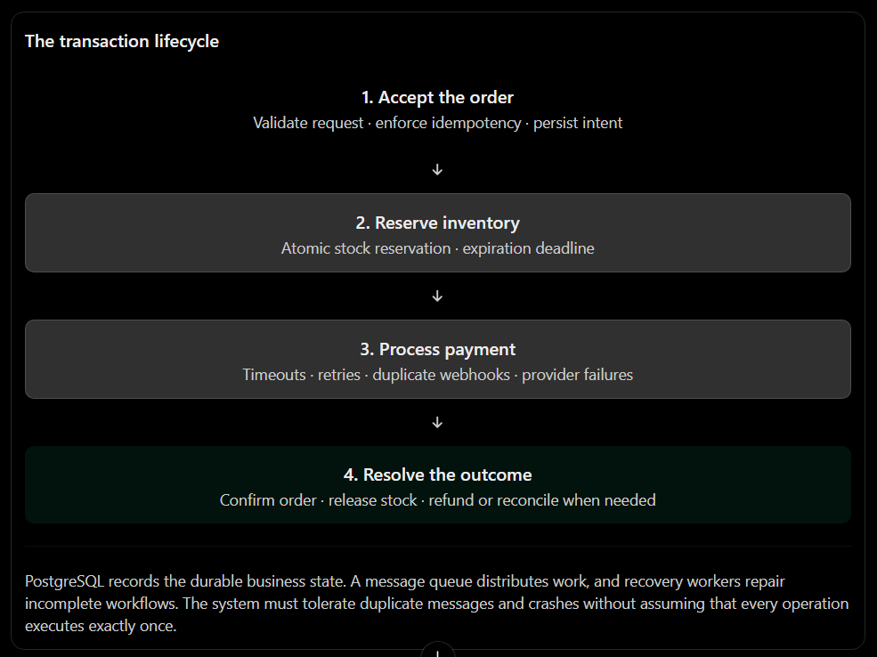
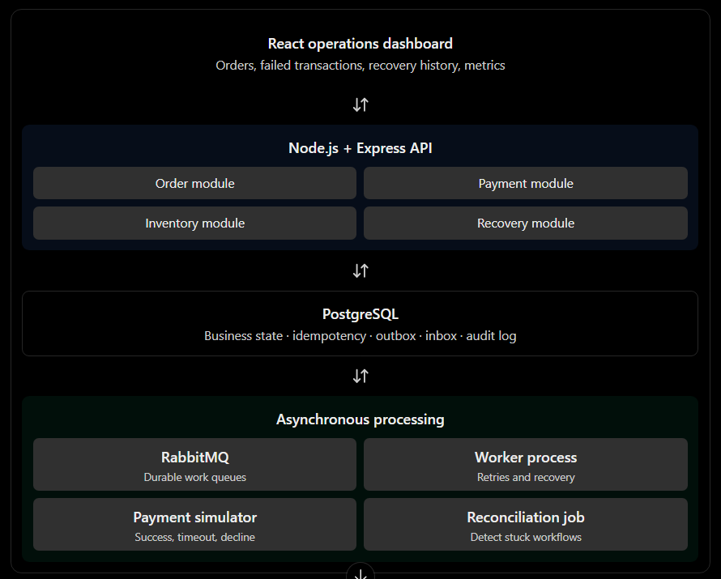
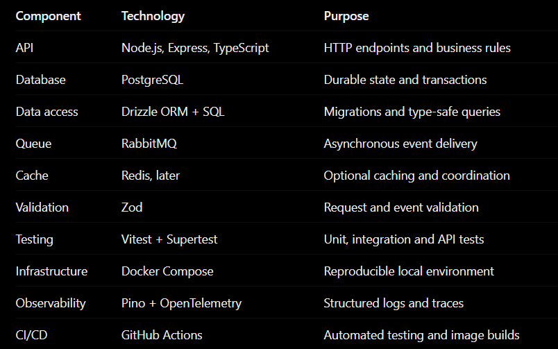

# Failed Transaction Reconciliation Engine

> A failure-resilient order processing and transaction recovery engine

## Primary focus

backend engineering and distributed systems. Build idempotent payment processing, inventory consistency, durable events, retry handling, and reconciliation for ambiguous transaction outcomes.

## Problem

A payment can succeed at a payment provider while the application times out before recording the result. Orders, payments and refunds can end up inconsistent.

Imagine a customer orders a laptop for ₹60,000.
Your system sends a payment request to a payment provider. The provider successfully charges the customer, but the network connection times out before your application receives the response.

What should happen next?

- If your application retries carelessly, the customer might be charged twice.

- If the order is marked failed, the customer could be charged for an order that appears cancelled.

- If inventory reservation fails, the payment and stock records can disagree.

- If the payment provider remains unavailable, requests can pile up and overload your system.

- If a worker crashes after processing an event, the same event might be delivered again.

These are real distributed-systems problems. A database transaction alone cannot atomically commit changes to your PostgreSQL database and an independent payment provider.
RecoverOps makes these failures explicit, detects inconsistent transactions, and safely drives them toward a resolved state.

Who would use it?

- E-commerce and marketplace engineering teams.

- SaaS companies integrating external billing or payment providers.

- Backend engineers who need reliable background job processing.

- Developers investigating failed, duplicated or stuck transactions.

For your portfolio, build a simulated payment provider first. You can demonstrate all the difficult failure scenarios without real payment credentials or real customer money.

## What makes this different from a normal order management project?

A typical project demonstrates the happy path:
Create order → Pay → Reduce stock → Success

RecoverOps focuses on the paths that break.


The key engineering principle: at-least-once delivery plus idempotent processing, rather than pretending you can guarantee exactly-once execution across independent systems.

## Technology stack and architecture

Keep the architecture challenging but achievable for one developer in 8–12 weeks.



## Recommended tools



## Architecture decision

start with a modular monolith for the API, a separate worker process, and a small payment simulator service. They share PostgreSQL but communicate asynchronously through RabbitMQ where appropriate. This gives you meaningful distributed failure scenarios without the operational burden of six independent microservices

Don't add Kubernetes, Kafka, or a complex microservice mesh just to make the architecture look impressive. A well-tested recovery workflow is much more valuable.

## MVP

The MVP should be a working transaction processing engine, not just a dashboard.

A. Order processing
Customers submit orders. The system validates products, calculates totals on the server, reserves inventory and tracks the order state.

B. Idempotent APIs
Repeating the same request with the same idempotency key returns the original result rather than creating another order or payment.

C. Reliable asynchronous jobs
Write events to a transactional outbox, publish them to RabbitMQ, and consume them using idempotent workers.

D. Automatic recovery
Implement bounded retries, backoff, dead-letter handling, stuck-transaction detection and reconciliation.

E. Failure simulation and observability
Inject timeouts, duplicate messages, crashes and payment declines. Show what happened, what the system did and how it recovered.

Explicitly leave these out of the first version

- Real payment processing.
- Multi-region deployments.
- Kubernetes and service mesh.
- Complex distributed sagas spanning many business domains.
- AI-based anomaly detection.
These are optional extensions, not prerequisites for demonstrating excellent backend engineering.

## PostgreSQL database schema

Design the schema around durable business state and recovery, rather than just CRUD operations.
Use UUID primary keys, timestamptz timestamps, numeric for monetary values, foreign keys, unique constraints, and explicit state checks.

### Core tables

This is the proposed MVP schema. The SQL below shows the key columns and constraints; indexes and operational fields are added in the implementation plan.

#### 1. products and inventory

```SQL
CREATE TABLE products (
  id uuid PRIMARY KEY,
  sku text NOT NULL UNIQUE,
  name text NOT NULL,
  price numeric(12,2) NOT NULL CHECK (price >= 0),
  active boolean NOT NULL DEFAULT true
);

CREATE TABLE inventory (
  product_id uuid PRIMARY KEY
    REFERENCES products(id),
  available_qty integer NOT NULL
    CHECK (available_qty >= 0),
  reserved_qty integer NOT NULL DEFAULT 0
    CHECK (reserved_qty >= 0),
  updated_at timestamptz NOT NULL DEFAULT now()
);
```

Keep physical stock and reservation accounting consistent. In the full design, define whether available_qty means sellable unreserved stock or physical stock, and never mix the two interpretations.

#### 2. orders and order_items

```SQL
CREATE TABLE orders (
  id uuid PRIMARY KEY,
  status text NOT NULL CHECK (
    status IN (
      'PENDING', 'CONFIRMED',
      'CANCELLED', 'REFUND_PENDING',
      'REFUNDED', 'REQUIRES_REVIEW'
    )
  ),
  total_amount numeric(12,2) NOT NULL
    CHECK (total_amount >= 0),
  currency char(3) NOT NULL DEFAULT 'INR',
  version integer NOT NULL DEFAULT 1,
  created_at timestamptz NOT NULL DEFAULT now(),
  updated_at timestamptz NOT NULL DEFAULT now()
);

CREATE TABLE order_items (
  id uuid PRIMARY KEY,
  order_id uuid NOT NULL REFERENCES orders(id),
  product_id uuid NOT NULL REFERENCES products(id),
  quantity integer NOT NULL CHECK (quantity > 0),
  unit_price numeric(12,2) NOT NULL
    CHECK (unit_price >= 0)
);
```

Store the agreed unit price in each order item so later product price changes don't rewrite order history. Derive totals on the server, never trust a client-submitted total.

#### 3. payments

```SQL
CREATE TABLE payments (
  id uuid PRIMARY KEY,
  order_id uuid NOT NULL REFERENCES orders(id),
  provider_ref text UNIQUE,
  status text NOT NULL CHECK (
    status IN (
      'PENDING', 'PROCESSING', 'SUCCEEDED',
      'FAILED', 'UNKNOWN', 'REFUND_PENDING',
      'REFUNDED'
    )
  ),
  amount numeric(12,2) NOT NULL
    CHECK (amount >= 0),
  attempt_count integer NOT NULL DEFAULT 0,
  created_at timestamptz NOT NULL DEFAULT now(),
  updated_at timestamptz NOT NULL DEFAULT now()
);
```

A timeout does not mean a payment failed. UNKNOWN represents an unresolved external outcome; reconcile it before issuing another charge. Add a constraint or partial unique index if the business permits only one successful payment per order.

#### 4. idempotency_keys

```SQL
CREATE TABLE idempotency_keys (
  key text PRIMARY KEY,
  request_hash text NOT NULL,
  status text NOT NULL CHECK (
    status IN ('IN_PROGRESS', 'COMPLETED')
  ),
  response_status integer,
  response_body jsonb,
  created_at timestamptz NOT NULL DEFAULT now(),
  expires_at timestamptz NOT NULL
);
```

Scope keys by authenticated client or tenant in the final implementation, such as a composite primary key (tenant_id, key). Reusing a key with a different request hash must return a conflict. Retain keys for a documented period.

#### 5. outbox_events

```SQL
CREATE TABLE outbox_events (
  id uuid PRIMARY KEY,
  aggregate_type text NOT NULL,
  aggregate_id uuid NOT NULL,
  event_type text NOT NULL,
  payload jsonb NOT NULL,
  created_at timestamptz NOT NULL DEFAULT now(),
  published_at timestamptz,
  attempts integer NOT NULL DEFAULT 0,
  next_attempt_at timestamptz NOT NULL DEFAULT now()
);
```

Persist an event in the same database transaction as the business change. A publisher later sends it to RabbitMQ and marks it published. Use a lease or row lock to coordinate multiple publishers; assume a crash can cause duplicate publication.

#### 6. processed_events and transaction_attempts

The inbox-style processed_events table deduplicates consumer processing. Insert the event ID and commit its business changes in the same PostgreSQL transaction. Keep attempts as append-only diagnostic records.

Add these tables during the recovery phase

- inventory_reservations: product, order, quantity, status, expiration time and release/commit timestamps.
- refunds: amount, provider reference, state and idempotency information.
- order_status_history: previous state, new state, reason and timestamp.
- reconciliation_runs: run status, counts and errors.
- reconciliation_items: mismatches found, actions attempted and final resolution.
For inventory, I recommend a reservation table rather than just changing quantities. It gives you an auditable answer to which order reserved stock, when that reservation expires, and whether it was committed or released.

### Essential indexes

```SQL
CREATE INDEX idx_outbox_pending
ON outbox_events (next_attempt_at, created_at)
WHERE published_at IS NULL;

CREATE INDEX idx_orders_status_created
ON orders (status, created_at DESC);

CREATE INDEX idx_payments_status_updated
ON payments (status, updated_at);

CREATE INDEX idx_reservations_expiry
ON inventory_reservations (expires_at)
WHERE status = 'ACTIVE';
```

Use EXPLAIN ANALYZE to validate the indexes against actual query patterns. Avoid adding indexes to every column by default.

## 6. REST API design

Use /api/v1 versioning, consistent error responses, Zod validation, and request correlation IDs.

### Orders and inventory

Method      Endpoint                        Purpose
POST        /api/v1/orders                  Create an order
GET         /api/v1/orders/:id              Get order and payment status
GET         /api/v1/orders                  Filter and paginate orders
POST        /api/v1/orders/:id/cancel       Request cancellation
GET         /api/v1/inventory/:productId    Check stock and reservations
GET         /api/v1/orders/:id/history      Inspect state transitions

For order creation, require an Idempotency-Key header.
Example:

```HTTP
POST /api/v1/orders
Idempotency-Key: checkout-9f81a

Content-Type: application/json
```

```JSON
{
  "items": [
    {
      "productId": "YOUR_PRODUCT_UUID",
      "quantity": 2
    }
  ]
}
```

The server calculates prices, reserves stock safely, persists the order and its outbox event, and returns an order ID. Repeating the request with the same key and same payload must not create another order.

A request with the same key but a different payload should return 409 Conflict.

### Payments and provider simulation

Method  Endpoint                         Purpose
GET     /api/v1/payments/:id             Inspect payment status
POST    /api/v1/webhooks/payments        Receive provider events
GET     /api/v1/admin/payment-attempts   Inspect payment attempts
POST    /api/v1/simulator/scenarios      Configure failure scenarios
POST    /api/v1/simulator/reset          Reset test data

The simulator endpoints should be available only in local or test environments, never exposed publicly in production.

### Useful simulation modes

- SUCCESS: payment completes normally.
- DECLINE: provider explicitly declines the payment.
- TIMEOUT_BEFORE_PROCESSING: provider never executes the payment.
- TIMEOUT_AFTER_SUCCESS: provider charges successfully but the response is lost.
- DUPLICATE_WEBHOOK: send the same provider event multiple times.
- DELAYED_RESPONSE: respond after the client's timeout.
- PROVIDER_UNAVAILABLE: return transient failures.

That distinction between a timeout before execution and a timeout after success is crucial. It lets you test whether your system can resolve an ambiguous outcome without accidentally charging twice.

### Recovery and operations APIs

Method      Endpoint                                    Purpose
GET         /api/v1/admin/recovery-jobs                 List pending or failed jobs
POST        /api/v1/admin/recovery-jobs/:id/retry       Request an authorized retry
GET         /api/v1/admin/reconciliation-runs           View reconciliation history
POST        /api/v1/admin/reconciliation-runs           Trigger a reconciliation run
GET         /api/v1/admin/metrics                       Return application-level metrics
GET         /health/live                                Process liveness check
GET         /health/ready                               Dependency-aware readiness check

Protect administrative endpoints with authentication and role-based authorization. Retry endpoints should enqueue work rather than directly repeat a potentially dangerous payment call.

## The difficult engineering challenges

These are the challenges that turn RecoverOps from a CRUD project into a strong backend portfolio project.

Challenge 1: Idempotency under concurrency

Failure: Ten simultaneous requests arrive with the same idempotency key.
Solution: Use a unique constraint and a transaction to claim the key, validate its request hash and persist the outcome. Handle concurrent inserts using PostgreSQL's conflict and locking mechanisms.
Test: Fire 100 concurrent identical requests. Verify that only one logical order is created and every successful replay refers to the same order.

Challenge 2: Prevent inventory overselling

Failure: Two orders attempt to reserve the last available unit at the same time.
Solution: Perform a conditional stock update inside a transaction, or lock the inventory row with SELECT ... FOR UPDATE. Use a reservation record with a unique order/product constraint where appropriate.
Test: Submit hundreds of competing reservations for limited stock. Assert that stock never becomes negative and total active reservations never exceed the sellable quantity.

Challenge 3: The transactional outbox

Failure: The order commits in PostgreSQL, but RabbitMQ is unavailable.
Solution: Save the order and event in one database transaction. A separate publisher reads unpublished events and sends them to RabbitMQ. Use durable queues, publisher confirms and retries.
Test: Stop RabbitMQ, create orders, restart RabbitMQ and verify that pending events are eventually published without losing the order.

Challenge 4: Duplicate delivery and worker crashes

Failure: A worker updates the database but crashes before acknowledging a message.
Solution: Use an inbox record and business-state changes in one database transaction. Acknowledge the RabbitMQ message only after the transaction commits.
Test: Crash the worker after the database commit but before acknowledgement. Redeliver the message and prove that the business effect isn't applied twice.

Challenge 5: Ambiguous payment outcomes

Failure: The payment provider succeeds, but the application times out.
Solution: Persist the payment attempt before calling the provider. Reuse a stable provider idempotency key, mark the outcome UNKNOWN when necessary, and query or reconcile the provider's recorded result before retrying.
Test: Simulate a successful charge with a lost response. Confirm that recovery eventually records the correct payment and does not create a second charge.

Challenge 6: State machines and compensation

Failure: A payment succeeds just as an inventory reservation expires or a cancellation request arrives.
Solution: Define allowed state transitions and make them atomic. Coordinate cancellation, payment confirmation and reservation commitment through explicit states and idempotent compensating actions.
Test: Race cancellation against payment success. Ensure the final state follows a documented policy and no charge or stock reservation is silently abandoned.

### One subtle but important design rule

Do not keep a PostgreSQL transaction open while making an HTTP call to the payment provider. The network can stall, locks can be held too long, and the database cannot roll back an external charge.
Instead:

1. Persist the intent and payment attempt.
2. Commit the database transaction.
3. Call the provider outside that transaction.
4. Persist the observed result.
5. Reconcile ambiguous results and retry only when safe.
Also, a circuit breaker prevents repeatedly calling an unhealthy dependency; it does not resolve an ambiguous payment outcome. That still requires idempotency and reconciliation.

## Build

A reusable backend service that detects, reconciles and resolves inconsistent business transactions.

- Payment and order state machines.
- Idempotent API requests.
- Webhook signature verification and duplicate-event handling.
- Retry policies with exponential backoff.
- Scheduled reconciliation against provider records.
- Dead-letter queues, manual review and complete audit history.

Why PostgreSQL? ACID transactions, unique constraints, durable event records and safe state transitions.
Advanced challenge: Recover correctly when a payment succeeds but the application crashes before updating the order.
This is especially good for demonstrating production backend engineering without needing to build a huge frontend.

## 10-week implementation roadmap

I'd target 10 weeks, leaving weeks 11–12 for deeper testing and polishing if needed. Build in dependency order: correctness first, distributed reliability second, presentation last.

Week 1
Foundation

Database and API foundation

- Set up Express, TypeScript, Drizzle and PostgreSQL.
- Create migrations, products, inventory, orders and order items.
- Implement validation, error handling and basic authentication.
- Write integration tests for core CRUD and database constraints.
Deliverable: a reliable, tested order API.

Week 2
Correctness

Idempotency and concurrency

- Implement idempotency keys and request fingerprints.
- Handle simultaneous duplicate requests.
- Add transactional inventory reservations.
- Test concurrent stock updates and cancellation.
Deliverable: no duplicate logical orders or overselling in tested scenarios.

Week 3
Payments

Payment simulator and state machines

- Implement payment attempts and provider references.
- Define valid order and payment state transitions.
- Add success, decline, timeout and delayed-response modes.
- Make webhook handling idempotent.
Deliverable: deterministic payment failure scenarios.

Week 4
Messaging

Transactional outbox and RabbitMQ

- Persist domain events in the same transaction as business changes.
- Build the outbox publisher and worker process.
- Add durable queues, publisher confirms and consumer acknowledgements.
- Implement inbox deduplication and safe redelivery.
Deliverable: asynchronous processing that survives broker outages and duplicate delivery.

Week 5
Resilience

Retries, backoff and circuit breaker

- Implement bounded exponential backoff with jitter.
- Distinguish transient failures from permanent declines.
- Configure timeouts and circuit-breaker states.
- Route exhausted jobs to a dead-letter queue.
Deliverable: controlled behavior during dependency failures.

Week 6
Recovery

Reconciliation and compensation

- Detect stuck payments and expired reservations.
- Compare internal state with simulated provider records.
- Resolve unknown outcomes and initiate safe refunds when required.
- Record every recovery attempt and final disposition.
Deliverable: recovery without manually editing database rows.

Week 7
Testing

Concurrency and chaos testing

- Run parallel order and payment requests.
- Kill workers at selected failure points.
- Disconnect RabbitMQ and restart services.
- Test duplicate webhooks, database rollbacks and competing state transitions.
Deliverable: reproducible failure tests with verifiable invariants.

Week 8
Observability

Logs, metrics and tracing

- Add correlation IDs across HTTP requests, events and workers.
- Instrument latency, retries, queue depth and recovery outcomes.
- Build an admin API and a simple React operations dashboard.
Deliverable: inspect an incident from request to recovery.

Week 9
Performance

Load testing and database tuning

- Benchmark order creation and worker throughput.
- Inspect slow queries using EXPLAIN ANALYZE.
- Tune indexes, connection pools and batch sizes.
- Measure failure recovery time under load.
Deliverable: documented benchmarks with reproducible test conditions.

Week 10
Delivery

Production-style delivery

- Docker Compose for the full stack.
- GitHub Actions for linting, tests and image builds.
- Deploy a demo environment if resources permit.
- Document architecture decisions, recovery guarantees and limitations.
- Record a demonstration of a failure and successful recovery.
Deliverable: a portfolio repository that another engineer can run and evaluate.

## How to prove the system actually works

Don't just say your application is fault-tolerant. Create a reproducible test suite demonstrating its guarantees.

Test scenario                                       Expected result
100 concurrent requests with one idempotency key    One logical order
100 reservations competing for 10 units             No more than 10 units reserved
RabbitMQ goes down during order creation            Order and outbox event remain durable
Worker crashes after committing its DB transaction  Redelivery does not duplicate business effects
Payment succeeds but response times out             Reconciliation discovers success without a second charge
Duplicate payment webhook arrives repeatedly        One logical state transition
Payment provider remains unavailable                Retries are bounded and circuit breaker opens
Reservation expires during an unresolved payment    Workflow reaches a documented, recoverable state

For the payment and inventory invariants, write integration tests against a real PostgreSQL instance. Mocking the database won't prove that PostgreSQL locking and transaction isolation behave correctly.

Measure and publish:

- API latency at p50, p95 and p99.
- Successful orders per second under a stated workload.
- Retry count and queue backlog.
- Number of duplicate logical operations prevented.
- Time taken to recover after a simulated outage.

Use real measured results, not invented benchmark claims.

## Repository structure

A clean monorepo will make the project much easier to maintain.

```plain text
recoverops/
├── apps/
│   ├── api/
│   │   └── src/
│   │       ├── modules/
│   │       │   ├── orders/
│   │       │   ├── payments/
│   │       │   ├── inventory/
│   │       │   └── recovery/
│   │       ├── middleware/
│   │       └── app.ts
│   ├── worker/
│   │   └── src/
│   │       ├── consumers/
│   │       ├── outbox/
│   │       └── jobs/
│   ├── payment-simulator/
│   └── web/
├── packages/
│   └── contracts/
├── database/
│   ├── migrations/
│   └── seeds/
├── tests/
│   ├── integration/
│   ├── concurrency/
│   ├── failure-injection/
│   └── load/
├── infra/
│   ├── docker/
│   └── github-actions/
├── docs/
│   ├── architecture.md
│   ├── state-machines.md
│   ├── failure-scenarios.md
│   └── adr/
├── docker-compose.yml
└── README.md
```

Keep business logic in services, database access in repositories, and HTTP handling in controllers. Don't let your Express routes become a giant collection of database queries.

## What should be in the README?

Your repository should make the engineering decisions easy to evaluate:

1. Problem statement and architecture diagram.
2. Setup instructions and environment variables.
3. Database schema and state-transition diagrams.
4. Explanation of idempotency, outbox/inbox and reconciliation.
5. Failure scenarios with steps to reproduce them.
6. Integration and concurrency test instructions.
7. Load-test methodology and measured results.
8. Known limitations and future improvements.
A particularly strong demonstration is to stop RabbitMQ, submit several orders, restart the broker, and show that pending work recovers without losing orders. Then simulate a successful payment with a lost response and demonstrate how reconciliation resolves it.

Build RecoverOps as a correctness-first, failure-tested distributed transaction engine. The first milestone is not RabbitMQ or the dashboard. It's proving that PostgreSQL transactions, idempotency and inventory reservations preserve your business invariants under concurrency.
Then add messaging, ambiguous external outcomes, retries, reconciliation and observability in that order.
